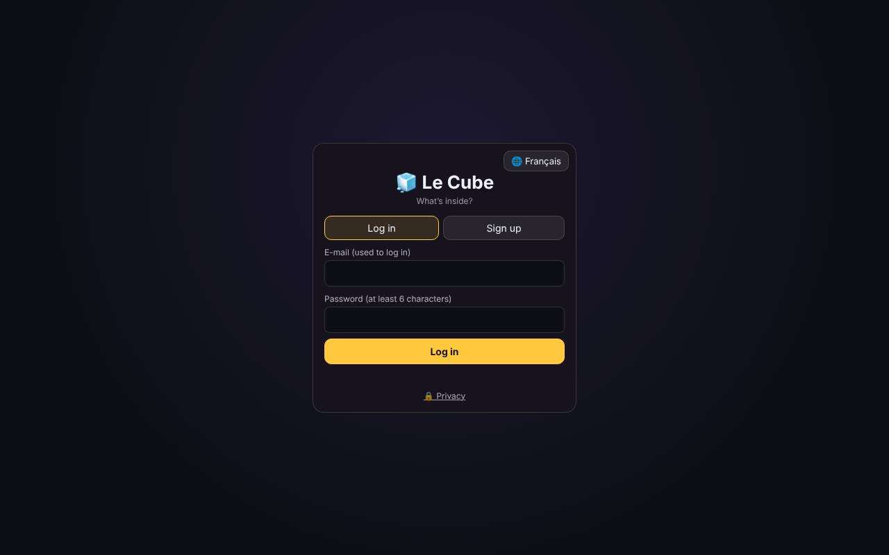
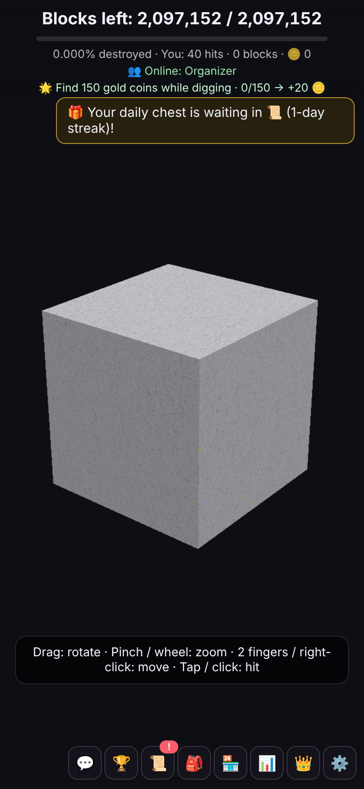
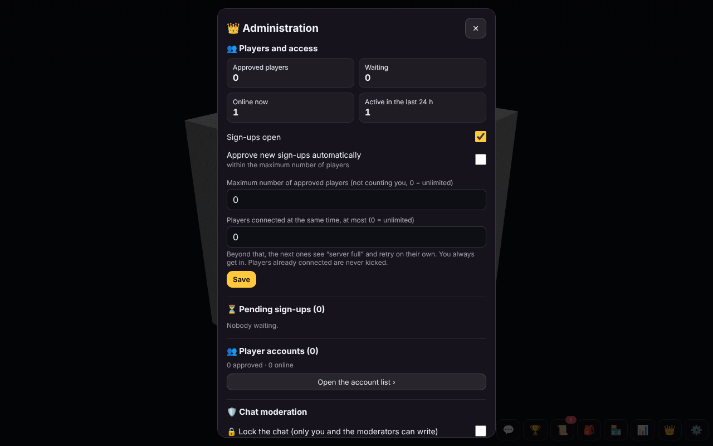

# 🧊 Le Cube — self-hosted multiplayer cube-digging game

**Le Cube** ("The Cube") is a small multiplayer 3D game that runs in the browser, inspired by the 2012 experiment *Curiosity: What's Inside the Cube?*. One giant cube made of millions of blocks sits in the middle of the screen. Everybody chips away at it **together**, layer by layer, finding gold, materials, chests and artifacts on the way down, until somebody reaches the centre.

This repository lets you **run your own copy on your own computer**: an old laptop is enough. Nothing to rent, no cloud database, no subscription. Players just open a web address on their phone or computer; nothing to install.

<p align="center">
  
  
</p>

> **Hobby project.** It was built for a family and friends, then opened as a small public test. Expect rough edges.
> It is not affiliated with 22cans or the original *Curiosity*.

---

## Table of contents

1. [What you get](#1-what-you-get)
2. [How it works (in two minutes)](#2-how-it-works-in-two-minutes)
3. [What you need](#3-what-you-need)
4. [Quick start on Windows (no command line)](#4-quick-start-on-windows-no-command-line)
5. [Putting it on the Internet: two options](#5-putting-it-on-the-internet-two-options)
   - [Option A — 100 % free (random address)](#option-a--100--free-random-address)
   - [Option B — your own domain name (paid, a few dollars a year)](#option-b--your-own-domain-name-paid-a-few-dollars-a-year)
6. [First steps as the organizer](#6-first-steps-as-the-organizer)
7. [Opening it to strangers (public server)](#7-opening-it-to-strangers-public-server)
8. [Security checklist](#8-security-checklist)
9. [Updating, backups and moving to another PC](#9-updating-backups-and-moving-to-another-pc)
10. [Optional extras](#10-optional-extras)
11. [Linux, macOS, Raspberry Pi and VPS](#11-linux-macos-raspberry-pi-and-vps)
12. [Configuration reference](#12-configuration-reference)
13. [Troubleshooting](#13-troubleshooting)
14. [Project layout](#14-project-layout)
15. [Credits and licence](#15-credits-and-licence)

---

## 1. What you get

**For players**
- A 3D cube (128³ = 2,097,152 blocks by default, any size from 10³ to 256³) that everybody digs together in real time.
- Layers of different materials (stone, wood, ice, lava, crystal…), hidden gold, materials, golden chests, artifacts and traps.
- A bag, a shop, a workshop to craft artifacts, daily missions, a daily chest with streaks, levels, seasons with reward tiers and medals.
- Combos, surprise events (golden hour…), player-vs-player duels, mining robots.
- Leaderboards per season and all-time, a hall of fame of finished cubes, and **replays** of every cube.
- Chat with private messages, reactions and @mentions; moderation tools.
- Push notifications on phones, installable as an app (PWA), a "TV mode" (`/?tv=1`) for a spare screen.
- Fully **bilingual: French and English** (follows the browser language; switchable).

**For you, the organizer (👑 panel)**
- Accounts: approve sign-ups manually or automatically, limits on accounts and on players online at the same time, **waiting line** when full.
- Game rules, prices, recipes, events, announcements, music radio (upload your MP3/M4A), custom sound pack (WAV).
- An **autopilot** 🧭 that keeps the game at the right pace for a target end date.
- Server health (CPU, memory, traffic, players) with live charts, a built-in load test.
- **Overload protection** 🔥: if the PC stays overloaded (CPU, game lag or memory above your thresholds for a couple of minutes), the game pauses for players with an apology message and automatic reconnection, and you get a phone notification.
- Nightly backups, one-click **rescue copy** of everything, and **updates from a zip** (even from your phone).
- An optional **admin dashboard** web page (stats, economy, security log, devices, read-only database explorer).
- Optional **e-mail** verification codes and "forgot password?" (via the free tier of Brevo or Resend), a privacy page, self-service account deletion.

## 2. How it works (in two minutes)

```
 Players' phones / PCs ──HTTPS──▶ Cloudflare ──secure tunnel──▶ cloudflared ──▶ server.js on YOUR computer
                                                                            (Node.js + built-in database)
```

- **`server.js`** is a single Node.js program. It serves the game page, handles the live connection (WebSocket) and stores everything in an **embedded PostgreSQL database** ([PGlite](https://pglite.dev)) inside a `donnees` folder. No separate database to install.
- **`public/index.html`** is the whole game client (it uses [three.js](https://threejs.org) for 3D, loaded from a CDN).
- **cloudflared** (a small free program from Cloudflare) creates an outgoing, encrypted tunnel so people on the Internet can reach your computer **without opening any port on your router** and without revealing your home IP address.

You can also play without the tunnel, on your home Wi-Fi only.

## 3. What you need

| | Minimum | Comfortable |
|---|---|---|
| Computer | Any PC from the last ~10 years running Windows 10/11 (Linux/macOS also work, see §11) | A small always-on PC or mini PC |
| Memory | 2 GB free | 4 GB+ |
| Disk | 1 GB | more if you upload music |
| Internet | Any; uploads are small | fibre/cable |
| Software | [Node.js](https://nodejs.org) **18 or newer** (take the **LTS** version) | |

The game uses **one CPU core** and a few hundred MB of RAM. A built-in load test on an old laptop handled well over 100 simulated players hitting non-stop; real players take breaks, so 15–40 at the same time is very comfortable on modest hardware.

The computer must stay **on and awake** while people play (see §13 for sleep settings).

## 4. Quick start on Windows (no command line)

Everything below is double-clicks.

1. **Download the game**: on this GitHub page, click the green **Code** button › **Download ZIP**.
2. **Unzip it**: right-click the zip › **Extract All…**, for example to `C:\LeCube`. (Avoid OneDrive/Desktop sync folders if you can; a plain folder like `C:\LeCube` is best.)
3. **Install Node.js** if you don't have it: go to [nodejs.org](https://nodejs.org), download the **LTS** installer for Windows, and click *Next* until it's done. (The next step also checks this and opens the page for you if needed.)
4. Double-click **`1-INSTALLER.bat`** (one time only). It checks Node.js, downloads `cloudflared.exe` (the tunnel), and installs the game's components. Wait for "Installation terminée !" (*installation finished*).
5. Double-click **`2-DEMARRER.bat`** (*start*). A black window opens: **leave it open**, it *is* the server. If it ever stops, it restarts by itself after 10 seconds.
6. Double-click **`5-OUVRIR-LE-JEU.bat`** (*open the game*), or open <http://localhost:8080> in your browser.
7. Click **Sign up** and create your account. **The very first account becomes the organizer (admin).** 👑 appears in the bottom bar.
8. Optional: double-click **`3-DEMARRAGE-AUTO-ACTIVER.bat`** so the server starts automatically every time you log in to Windows (`4-DEMARRAGE-AUTO-DESACTIVER.bat` undoes it).

> 💡 Windows SmartScreen may warn about the `.bat` files because they come from the Internet: click **More info › Run anyway**. They are short plain-text scripts; you can open them with Notepad to read them first.

**Playing at home without Internet access**: the black window prints an address like `http://192.168.1.20:8080`. Any phone or PC on the same Wi-Fi can open it.

The interface and the server messages are in French with English translations in the game itself; the `.bat` file names are French:
`INSTALLER` = install, `DEMARRER` = start, `DEMARRAGE-AUTO-ACTIVER/DESACTIVER` = autostart on/off, `OUVRIR-LE-JEU` = open the game.

## 5. Putting it on the Internet: two options

### Option A — 100 % free (random address)

**Nothing to do.** As long as there is no tunnel token saved, `server.js` automatically starts a free Cloudflare "quick tunnel" when it starts.

1. Start the server (`2-DEMARRER.bat`).
2. After a few seconds, the address appears:
   - in the black window,
   - in the file **`ADRESSE-DU-JEU.txt`** next to the program,
   - and in the game: 👑 › **Server** (🌍 line at the top).
   It looks like `https://some-random-words.trycloudflare.com`.
3. Send that address to your players. It is HTTPS, so phone notifications and "install as an app" work.

**Limits of the free option**
- ⚠️ **The address changes every time the server restarts** (PC reboot, update, crash). You have to send the new one each time, and players who installed the app or turned on notifications must redo it on the new address.
- Quick tunnels are meant for testing: no uptime guarantee, and Cloudflare caps them (a few hundred simultaneous requests), which is fine for a group of friends.
- You can't add Cloudflare protections (firewall rules, Access) to an address you don't own.

Perfect to try the game or for a family that doesn't mind a new link now and then. For a stable address, use option B.

### Option B — your own domain name (paid, a few dollars a year)

You get a permanent address like `https://my-cube.xyz`, and all of Cloudflare's free protections. The only cost is the domain name: cheap extensions often cost **a few dollars or euros per year** (prices vary a lot by extension; check before buying). The Cloudflare account, tunnel and protections are free.

#### B1. Create a Cloudflare account and get a domain
1. Create a free account at [dash.cloudflare.com](https://dash.cloudflare.com/sign-up).
2. Get a domain, either:
   - **directly at Cloudflare** (simplest): *Domain Registration › Register Domains*, search a name, pay. Cloudflare sells at cost, and the domain is already set up; or
   - **at any registrar** (OVH, Namecheap, Gandi, Porkbun…), then in Cloudflare click **Add a domain** (free plan) and, at your registrar, replace the "nameservers" with the two Cloudflare gives you. Wait until Cloudflare says the domain is **Active** (minutes to a few hours).

#### B2. Create the tunnel
Cloudflare renames these menus from time to time; look for **Tunnels**.
1. In the Cloudflare dashboard, open **Zero Trust** (left menu), then **Networks › Tunnels**. Newer dashboards also show it directly under **Networks › Tunnels**. The first time, Zero Trust asks you to pick a team name and the **Free** plan; a payment card may be requested for verification, but the free plan costs nothing.
2. Click **Create a tunnel** › type **Cloudflared** › give it a name (e.g. `le-cube`) › **Save**.
3. On the "install connector" page, pick **Windows** and **copy the command** shown (it contains a long token starting with `eyJ…`). **Don't run it.**
4. Open the game as organizer › 👑 › **Server** › field **"Permanent address (Cloudflare tunnel token)"** › paste the whole command (or just the `eyJ…` token) › **Save and restart**. The server restarts and connects with your tunnel; the tunnel page in Cloudflare should show it as **Healthy**. The token is stored in `tunnel-jeton.txt` (keep it secret).
5. Back in Cloudflare, in your tunnel, add a **public hostname** (newer dashboards: **Routes › Add a route › Published application**):
   - **Subdomain**: empty (for `my-cube.xyz`) or e.g. `play` (for `play.my-cube.xyz`)
   - **Domain**: your domain
   - **Path**: empty
   - **Service**: **HTTP** and `localhost:8080`; if there is only one "Service URL" field, type `http://localhost:8080`
   - Save. Cloudflare creates the DNS record automatically.
6. Open `https://my-cube.xyz`. 🎉 If a phone says the site doesn't exist (`DNS_PROBE_FINISHED_NXDOMAIN`) while a PC works, the phone remembers an old answer: toggle airplane mode or wait 30 minutes.

To go back to option A: 👑 › Server › **Back to the free address**.

## 6. First steps as the organizer

Everything is in **👑** (bottom bar). Important buttons ask for confirmation to avoid accidental taps.

<p align="center"></p>

1. **Players and access**: sign-ups open or closed, **approve automatically** (or approve each person by hand), maximum number of accounts, and **maximum players online at the same time**. Above that number, newcomers join a **waiting line**: they see their position and an estimated wait, and get in automatically. While people wait, inactive players (nothing done for 10 min, or game hidden for 3 min) give their spot away. You, the organizer, always get in.
2. **Forgotten password** (without e-mail set up): open the account list and use 🔑 to set a new password for the player.
3. **Game rules**: hits per block, how often gold and materials appear, shop prices, workshop recipes, events, traps, robots… Starting a **new cube** lets you pick its size (10 to 256).
4. **Autopilot 🧭**: give a target number of days to finish the cube; it gently adjusts hidden artifacts, chests, gold and materials (and optionally prices and recipes) every 10 minutes, only while players are online.
5. **Server**: health and charts, backups, rescue copy, updates, tunnel, load test (🧪 "How many players can your server handle?").
6. **⚙️ Settings › 🔔 Notifications** on your own phone: get alerted about new sign-ups, first connections, and logins to your organizer account.

## 7. Opening it to strangers (public server)

For a Discord or Reddit community, three extra things are recommended:

### 7.1 Real e-mail addresses (sign-up code + "Forgot password?")
Uses a transactional e-mail service. **[Brevo](https://www.brevo.com)** has a free plan with 300 e-mails per day; **[Resend](https://resend.com)** also has a free tier. You need your own domain (option B) so the e-mails come from it.

With Brevo:
1. Create a free account and fill in the profile Brevo asks for.
2. ⚙️ (top right) › **Senders, domains & dedicated IPs** › **Domains** › **Add a domain** › your domain (the main one, e.g. `my-cube.xyz`, not the game subdomain). If Brevo offers a custom tracking subdomain, you can leave it empty. Choose the **automatic Cloudflare** setup if offered; otherwise copy the DNS records it shows into Cloudflare › your domain › **DNS › Records**. Wait until the domain shows **Authenticated**.
3. **Senders** › **Add a sender**: name `Le Cube`, address e.g. `no-reply@my-cube.xyz` (the mailbox doesn't need to exist).
4. ⚙️ › **SMTP & API** › **API keys** tab (not the SMTP tab) › **Generate a new API key**. Choose **Restricted** access and set **Transactional emails** to **All** (everything else: None). Copy the key with Brevo's copy button: it starts with **`xkeysib-`** and is shown only once.
5. In the game: 👑 › **Server** › **✉️ E-mails and privacy** › service **Brevo**, paste the key, sender address, tick **E-mail code required to sign up** and **"Forgot password?" by e-mail** › **Save** › send yourself a **test e-mail** (check spam the first time).

> Brevo disables API keys after ~90 days without use. If the test later says "key refused", create a new key the same way.

### 7.2 Privacy
- A privacy page is served at `/confidentialite` (linked on the login screen). It adapts to your settings.
- In ✉️, set **Player device sheets** to **Basic** (browser, screen, language; no city, no IP) for strangers, and fill in a **contact** shown on the privacy page.
- Players can delete their own account in ⚙️ Settings.
- An optional **ℹ️ About** button (your name, contact e-mail, links) can be enabled in the same panel.

### 7.3 Limits
Turn on **🔥 Overload protection** in 👑 › Server (on by default for a second server with an `instance.json`). Defaults: pause when the PC processor stays ≥ 92 %, the game lags ≥ 300 ms, or memory is ≥ 96 % for 2 minutes in a row; players are disconnected with an apology and reconnect automatically after 15 minutes (twice as long if it happens again within 3 hours). You stay connected and can reopen at any time. Use **Test the notification** to check your phone gets the alert.

Set **players online at the same time** (👑 › Players and access) to something your PC handles easily, e.g. **15–20** to start, then raise it while watching the server charts. Turn on **approve automatically** with a sensible maximum number of accounts.

## 8. Security checklist

Already built in:
- No port opened on your router (outgoing tunnel only); your home IP is hidden behind Cloudflare.
- Passwords hashed (scrypt), sessions as random tokens, rate limits on login/sign-up/codes, lockout after repeated wrong passwords, admin-only actions checked on the server, strict input validation, security headers.
- Push alert to the organizer on every login to the organizer account, and a security journal (dashboard › Security tab).

Recommended with option B (all free, in the Cloudflare dashboard of your domain):
1. **SSL/TLS** › mode **Full**; **Always Use HTTPS** on; **Minimum TLS version 1.2**.
2. **Security › WAF › Custom rules** › block obvious scanners, for example this expression (Action: **Block**):
   ```
   (http.request.uri.path contains "/wp-") or (http.request.uri.path contains ".php") or (http.request.uri.path contains "/.env") or (http.request.uri.path contains "/.git")
   ```
3. **Security › WAF › Rate limiting rules** (1 rule on the free plan): for example, requests whose path is one of `/api/login`, `/api/signup`, `/api/signup-code`, `/api/reset-code`, more than ~20 per minute from the same IP → **Block** for 10 minutes.
4. If you use the admin dashboard: **Zero Trust › Access › Applications › Add an application › Self-hosted**, hostname = your domain, path = `tableau`, policy **Allow** = your own e-mail, login method **One-time PIN**. Now `/tableau` asks for a code sent to your e-mail before even reaching your PC.
5. Optionally turn on **DNSSEC** (DNS › Settings) and turn off **Rocket Loader** (Speed › Optimization) if you see display issues.

At home:
- Use a **dedicated computer** for the server if you can, and **don't stay logged in** to your personal accounts on it: sign out of the browser's Google/Microsoft account, no saved passwords, no e-mail or banking on that machine.
- If your router has a **guest Wi-Fi**, put the server on it: even in the worst case, an intruder would be cut off from your other devices. (Guest Wi-Fi is usually not relayed by Wi-Fi repeaters, and an Ethernet cable puts the PC back on your main network.)
- Keep Windows and Node.js up to date (Node.js: install the new LTS `.msi` over the old one).

## 9. Updating, backups and moving to another PC

**Update the game** (keeps the game, accounts and settings):
1. Download the new version's zip (GitHub › **Code › Download ZIP**, or a release zip).
2. In the game: 👑 › **Server** › **📦 Install an update…** › choose the zip (works from a phone too).
3. The server makes a backup, replaces only the program files (`server.js`, `schema.sql`, `public/…`, package files, French readme/changelog), and restarts. If the new version fails to start, it rolls back automatically. **↩️ Go back to the previous version** is also available.

If a new version adds a dependency (changes in `package.json`), delete the `node_modules` folder and run `1-INSTALLER.bat` again.

**Backups**
- Automatic, every night at 5:00, the last 10 kept in `sauvegardes/`. Manual backup, download and restore from 👑 › Server.
- The database is tidied every night at 4:45 (a few seconds).

**🛟 Full rescue copy**: 👑 › Server › *Full rescue copy* downloads one zip with **everything** (program, game, accounts, settings, keys, optionally music, replays and backups). To restore on another PC: unzip, `1-INSTALLER.bat`, `2-DEMARRER.bat`. Instructions are inside the zip. ⚠️ It contains secrets (password hashes, tunnel token, keys): keep it private. Never run the old and the new PC at the same time with the same tunnel token.

## 10. Optional extras

### Admin dashboard (`/tableau/`)
A separate, read-only statistics page (game, players, economy, chat, autopilot, security, devices, server, database explorer). It never touches the game.
1. 👑 › **Server** › **📈 Dashboard** › choose the file **`dashboard/tableau-de-bord.html`** from this repository.
2. Open `https://your-address/tableau/` in the same browser where you are logged in as organizer.
3. Protect it with Cloudflare Access (§8, point 4).

### A second, separate server on the same PC
Useful to keep a private family game and a public test server side by side. Each copy has its own game, accounts and settings.
1. Copy the whole program folder to a new folder (e.g. `C:\LeCube-TEST`), **without** the data folders (`donnees`, `sauvegardes`, `musique`, `rejeux`, `bruitages`) and without `tunnel-jeton.txt`.
2. In the new folder, copy `instance.example.json` to **`instance.json`** and adjust it:
   ```json
   { "port": 8081, "tunnel": false, "name": "Public test server" }
   ```
   `port` must differ from the first server's; `"tunnel": false` means "use the first server's tunnel"; `name` is shown on the login screen.
3. Edit `5-OUVRIR-LE-JEU.bat` to open `http://localhost:8081`, and in `3-`/`4-DEMARRAGE-AUTO-…bat` change the shortcut name `Le Cube - serveur.lnk` to something else (e.g. `Le Cube TEST - serveur.lnk`).
4. Run `1-INSTALLER.bat`, `2-DEMARRER.bat`, create the first account (organizer of this server).
5. In Cloudflare, in **the same tunnel**, add a second public hostname: e.g. `test` + your domain → `http://localhost:8081`.

`instance.json` is never touched by in-game updates.

### Music radio, sounds, photo
- 👑 › **Music**: upload MP3/M4A tracks; everybody hears the same "radio" (players can choose the game's own music instead).
- 👑 › **Sounds**: upload WAV files per material and event (break, hit, place). The game also has its own synthesized sounds, so this is optional. Only upload sounds you have the right to use.

### TV screen
Open `https://your-address/?tv=1` on a TV or spare screen and log in: the cube spins with live leaderboards and news.

## 11. Linux, macOS, Raspberry Pi and VPS

The `.bat` files are only Windows helpers; the server itself is plain Node.js.

```bash
# 1. get the code
git clone https://github.com/nbbou81000/le-cube-server.git
cd le-cube-server

# 2. install dependencies (Node.js 18+ required)
npm install --omit=dev

# 3. install cloudflared (only needed for Internet access)
#    macOS:   brew install cloudflared
#    Debian/Ubuntu/Raspberry Pi OS: see https://pkg.cloudflare.com/ or download the binary
#    from https://github.com/cloudflare/cloudflared/releases and put it next to server.js
#    (named "cloudflared") or anywhere in your PATH.

# 4. start
node server.js
```

Then open `http://localhost:8080`. The free tunnel address is written to `ADRESSE-DU-JEU.txt`; for a domain, paste the tunnel token in 👑 › Server as described in §5.

**Keep it running with systemd** (Linux):
```ini
# /etc/systemd/system/lecube.service
[Unit]
Description=Le Cube game server
After=network-online.target
Wants=network-online.target

[Service]
WorkingDirectory=/opt/le-cube-server
ExecStart=/usr/bin/node server.js
Restart=always
RestartSec=10
User=lecube
# Environment=PORT=8080

[Install]
WantedBy=multi-user.target
```
```bash
sudo systemctl daemon-reload && sudo systemctl enable --now lecube
journalctl -u lecube -f      # logs
```

**On a VPS**, a typical setup is `HOST=127.0.0.1` (listen only locally; players come through the tunnel), `LECUBE_DATA=/var/lib/lecube` (data outside the program folder), and optionally `STATUS_PORT=80` for a tiny page showing the current game address. When `LECUBE_DATA` is set, the in-game updater and rescue copy are hidden (update with `git pull` + restart instead).

Raspberry Pi 4/5 (64-bit OS) should be fine for a small group; the database is WebAssembly and runs anywhere Node.js does.

## 12. Configuration reference

**`instance.json`** (optional, next to `server.js`):

| Key | Default | Meaning |
|---|---|---|
| `port` | `8080` | HTTP port |
| `tunnel` | (on) | `false` = don't start cloudflared (second server sharing the first one's tunnel) |
| `name` | empty | Name shown under the title on the login screen |

**Environment variables** (override `instance.json`):

| Variable | Meaning |
|---|---|
| `PORT` | HTTP port |
| `HOST` | Listen address (e.g. `127.0.0.1` on a VPS) |
| `LECUBE_DATA` | Folder for all data and settings (default: the program folder) |
| `TUNNEL=0` | Never start cloudflared |
| `STATUS_PORT` | Extra tiny status page port (VPS) |
| `VAPID_SUBJECT` | Contact URL or `mailto:` sent to push services |
| `LECUBE_MAIL_FILE` | Development only: write e-mails to this file instead of sending them |

**Files created at runtime** (all ignored by git; never commit them):

| File / folder | Content |
|---|---|
| `donnees/` | The database: game, accounts (**don't delete**) |
| `sauvegardes/` | Nightly backups |
| `tunnel-jeton.txt` | Cloudflare tunnel token (**secret**) |
| `notifications-cles.json` | Push notification keys (**secret**; without them everyone must re-enable notifications) |
| `reglages-publics.json` | E-mail service key, privacy and About settings (**secret**) |
| `trmnl-cle.txt` | Key for the optional e-ink (TRMNL) data endpoint (**secret**) |
| `ADRESSE-DU-JEU.txt` | Current public address |
| `musique/`, `rejeux/`, `bruitages/`, `photo-du-cube.jpg` | Uploaded music, replays, sounds, photo |
| `historique-serveur.json`, `stats-serveur.json`, `journal-*.json`, `alertes-connexion.json` | Charts, statistics, session and security logs |
| `tableau-de-bord/` | The uploaded admin dashboard page |
| `version-precedente/` | Copy kept for "go back to the previous version" |

## 13. Troubleshooting

| Problem | Fix |
|---|---|
| `1-INSTALLER.bat` says Node.js is missing or too old | Install the **LTS** from nodejs.org, then **close and reopen** the folder and run it again. |
| The black window closes immediately | Run `1-INSTALLER.bat` first. If it still closes, open a Command Prompt in the folder and run `node server.js` to read the error. |
| `EADDRINUSE` / port already in use | Another program (or a second copy) uses 8080: stop it, or set another `port` in `instance.json`. |
| Cloudflare error **502 / 1033** on your domain | The server isn't running, the tunnel isn't connected (👑 › Server, 🌍 line), or the route's service URL isn't exactly `http://localhost:8080` (or your port). |
| Phone says the site doesn't exist (`NXDOMAIN`) but the PC works | DNS cache: toggle airplane mode, switch Wi-Fi/4G, or wait ~30 min. |
| The free address changed | Normal with option A after every restart; see `ADRESSE-DU-JEU.txt`. Use option B for a fixed address. |
| Test e-mail: "key refused" / `401 Key not found` | Use an **API key** (`xkeysib-…`), not an SMTP key; with restricted access, set **Transactional emails = All**; paste it completely. |
| E-mails go to spam | Make sure the domain is **Authenticated** in Brevo (DKIM/DMARC records present in Cloudflare DNS). |
| No phone notifications | They need HTTPS and a stable address (option B). iPhone: add the game to the home screen first, then enable ⚙️ › 🔔. |
| The game stops at night | Windows › Settings › System › Power › **Screen and sleep**: set "put my device to sleep" to **Never** when plugged in. On a laptop, also set "closing the lid" to **Do nothing** (Control Panel › Power Options). |
| Players say "server full" | Raise "players online at the same time" in 👑, or let the waiting line do its job. |
| Something broke after an update | 👑 › Server › **↩️ Go back to the previous version**. Backups are in `sauvegardes/`. |

## 14. Project layout

```
server.js                 the whole server (HTTP, WebSocket, game logic glue, tunnel, backups, updater…)
schema.sql                database schema and game rules (PostgreSQL functions), applied at every start
public/index.html         the whole game client (three.js), French + English
public/sw.js, manifest…   installable app (PWA) and icons
dashboard/                optional admin dashboard page (upload it from 👑 › Server)
docs/                     screenshots for this README
instance.example.json     template for a second server on the same PC
1-…5-*.bat                Windows helpers (install, start, autostart on/off, open)
LISEZ-MOI.txt             short French guide; NOUVEAUTES.txt = French changelog
```

Code comments and server logs are in French; the player and organizer interface is in French and English.

## 15. Credits and licence

- Created by **Nicolas Bouteiller** (Nico).
- Inspired by *Curiosity: What's Inside the Cube?* (22cans, 2012). No code or assets from it are used.
- Built with [Node.js](https://nodejs.org), [PGlite](https://pglite.dev) (embedded PostgreSQL), [three.js](https://threejs.org), [ws](https://github.com/websockets/ws), [web-push](https://github.com/web-push-libs/web-push) and [Cloudflare Tunnel](https://developers.cloudflare.com/cloudflare-one/connections/connect-networks/).

Released under the **[MIT licence](LICENSE)**: you may use, modify and share it freely, including in your own projects, as long as you keep the copyright notice.

If you run your own cube, feel free to open an issue to say hi or share feedback. ☕ Enjoying it? [Support the author on Ko-fi](https://ko-fi.com/nicolasbouteiller).
